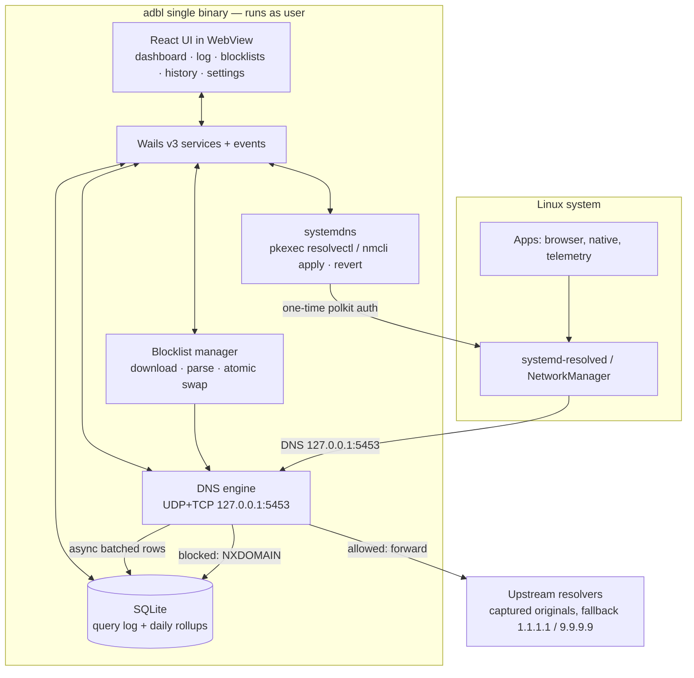

# SDA — Software Design & Architecture

## 1. Context



## 2. Decisions (ADR-style)

| # | Decision | Rationale | Rejected alternative |
|---|---|---|---|
| ADR-1 | **DNS sinkhole** | System-wide (all apps), full query log for monitoring/stats, no CA/MITM | Hosts file (no live log, slow with big lists); HTTP proxy (needs MITM, browser-centric) |
| ADR-2 | **Port 5453, loopback only** | 5353 is owned by Avahi/mDNS (`0.0.0.0:5353`) → bind would fail; loopback ⇒ never an open resolver | Port 53 (needs root), 5353 (conflict) |
| ADR-3 | **Unprivileged engine + one-time polkit** | GUI runs as user; elevation is a fixed argv `exec.Command("pkexec","resolvectl",…)` — no shell interpolation | Whole app as root; installed systemd daemon (deferred, documented upgrade path) |
| ADR-4 | **Single binary** | Engine + services + embedded UI; no daemon install, simple distribution | Split daemon + UI socket (P2 if root-free port 53 is ever needed) |
| ADR-5 | **Restore-first safety** | Previous DNS persisted to state file *before* apply; restore on graceful exit, next-start repair, manual fallback documented | Restore only on exit (strands DNS after crash) |
| ADR-6 | **Forward to captured original upstreams** | Identical behavior/latency to pre-install; no surprise resolver change | Always-forward to public DNS (changes privacy/latency semantics) |
| ADR-7 | **Local-only telemetry** | Only outbound traffic = blocklist HTTPS downloads | Any remote stats |
| ADR-8 | **Suffix-walk map for blocking** | O(labels) lookup, no extra dependency, hot-swappable via `atomic.Pointer` | Domain trie library; bloom+exact (overkill for one snapshot set) |

## 3. Blocking pipeline (per query)

```
query ─► allowlist hit? ──yes──► forward
           │no
           ▼
   suffix walk: a.b.c.com → b.c.com → c.com → com
           │hit
           ▼
   NXDOMAIN + log(blocked, source)          allowed → forward upstream + log
```

## 4. Safety model (the core invariant)

> **Invariant:** the system must never point DNS at a dead adbl.

1. State file `~/.local/share/adbl/state.json` written **before** applying.
2. Restore on graceful exit (deferred hook).
3. On start: if state file says we own DNS but engine is not running → repair
   (re-apply if healthy, else revert).
4. Manual fallback documented: `resolvectl revert` / `nmcli` commands in README.
5. Engine binds loopback only; elevation uses fixed argv, validated interface names.

## 5. Failure modes

| Failure | Handling |
|---|---|
| Blocklist download fails | Keep current snapshot; surface error in UI; retry next cycle |
| Upstream timeout | SERVFAIL after 3s; query still logged |
| Polkit denied | No state change; UI shows "not protected" with retry |
| App hard-killed | Next start repairs from state file (see invariant) |
| Port 5453 busy | Startup error surfaced in UI with offending-addr hint |

## 6. Privacy

All config, logs and stats live in the user's home dirs. No telemetry, no
account, no remote endpoints except blocklist sources over HTTPS.

## 7. Upgrade path (documented, not built)

- Split systemd daemon for root-free port 53 / multi-user.
- DoH/DoT upstreams; per-client policies; cosmetic filtering companion extension.
